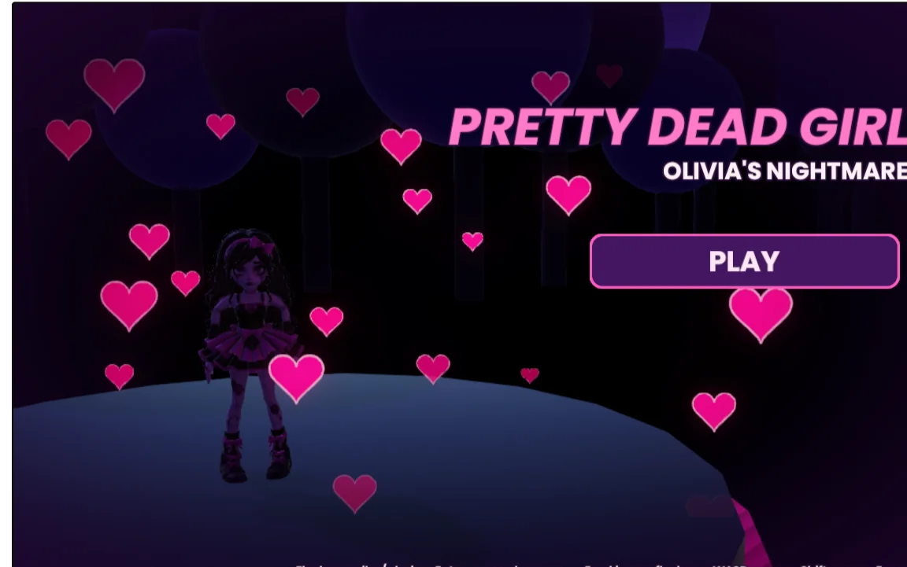
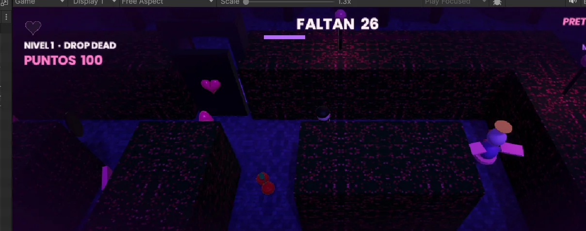

# 💗 Pretty Dead Girl: Olivia's Nightmare

**Videojuego 3D desarrollado en Unity 6 — disponible para jugar en el navegador.**

[](https://denistae.github.io/PrettyDeadGirl_Portal_GitHub/)
[](https://unity.com/)
[](https://docs.unity3d.com/)



## 🌙 Sobre el videojuego

**Pretty Dead Girl: Olivia's Nightmare** es un videojuego 3D de exploración y supervivencia. Controlas a Olivia mientras atraviesa escenarios misteriosos, esquiva enemigos y recoge los elementos necesarios para completar cada nivel.

El diseño combina laberintos oscuros, corazones de colores, ambientación fantástica y una estética morada y rosa.

## 🎮 Jugar ahora

- **[Abrir portal oficial](https://denistae.github.io/PrettyDeadGirl_Portal_GitHub/)**
- **[Ejecutar el juego directamente](https://denistae.github.io/PrettyDeadGirl_Portal_GitHub/game/)**

El juego está pensado principalmente para PC con teclado. Recomendado: Chrome, Microsoft Edge o Firefox actuales.

## 🧩 Niveles

| Nivel | Nombre | Descripción |
| --- | --- | --- |
| 1 | **Drop Dead** | Comienza el recorrido y familiarízate con los laberintos, los coleccionables y los enemigos. |
| 2 | **Purple** | Continúa la aventura en el segundo escenario. |
| 3 | **Stupid Song** | Afronta el capítulo final. |

## ⌨️ Controles

| Tecla | Acción |
| --- | --- |
| `W A S D` o `↑ ← ↓ →` | Mover al personaje |
| `Shift` | Correr |
| `C` | Cambiar cámara |
| `V` | Activar habilidad/rayos |
| `R` | Reiniciar nivel |
| `Esc` | Pausar |

## 📷 Capturas



## 👩‍💻 Desarrolladores

- **Denis Medrano Carrasco** — [GitHub @DenisTae](https://github.com/DenisTae)
- **Ariana Patzi Gonzales** — codesarrolladora del proyecto

## 🛠️ Tecnologías

- Unity 6
- C#
- Unity WebGL
- HTML5, CSS3 y JavaScript
- Git y GitHub Pages

## 📁 Estructura

```text
PrettyDeadGirl_Portal_GitHub/
├── index.html              # Portal principal
├── style.css               # Diseño responsive
├── script.js               # Menú, galería y juego integrado
├── README.md               # Documentación
├── assets/
│   ├── menu.webp           # Captura real del menú
│   ├── nivel1.webp         # Captura real del nivel 1
│   └── favicon.svg
└── game/                    # Compilación Unity WebGL existente
    ├── index.html
    ├── Build/
    └── TemplateData/
```

## 🚀 Publicación en GitHub Pages

1. Mantén intacta la carpeta `game/` que exportaste desde Unity.
2. Coloca los archivos del portal (`index.html`, `style.css`, `script.js`, `README.md` y `assets/`) en la **raíz del repositorio**.
3. Confirma los cambios en Git y realiza Push a `main`.
4. En **Settings → Pages**, configura **Deploy from a branch**, rama `main`, carpeta `/ (root)`.
5. Visita `https://denistae.github.io/PrettyDeadGirl_Portal_GitHub/`.

> **Nota sobre la música:** este repositorio es público. Antes de distribuir música comercial incorporada al WebGL, asegúrate de contar con los derechos o permisos correspondientes; de lo contrario usa audio original o con licencia compatible.

## 📄 Aviso

Proyecto académico desarrollado por **Denis Medrano Carrasco y Ariana Patzi Gonzales**. Las capturas incluidas son del videojuego aportadas por sus desarrolladores. No se incluye música comercial en este paquete del portal.
